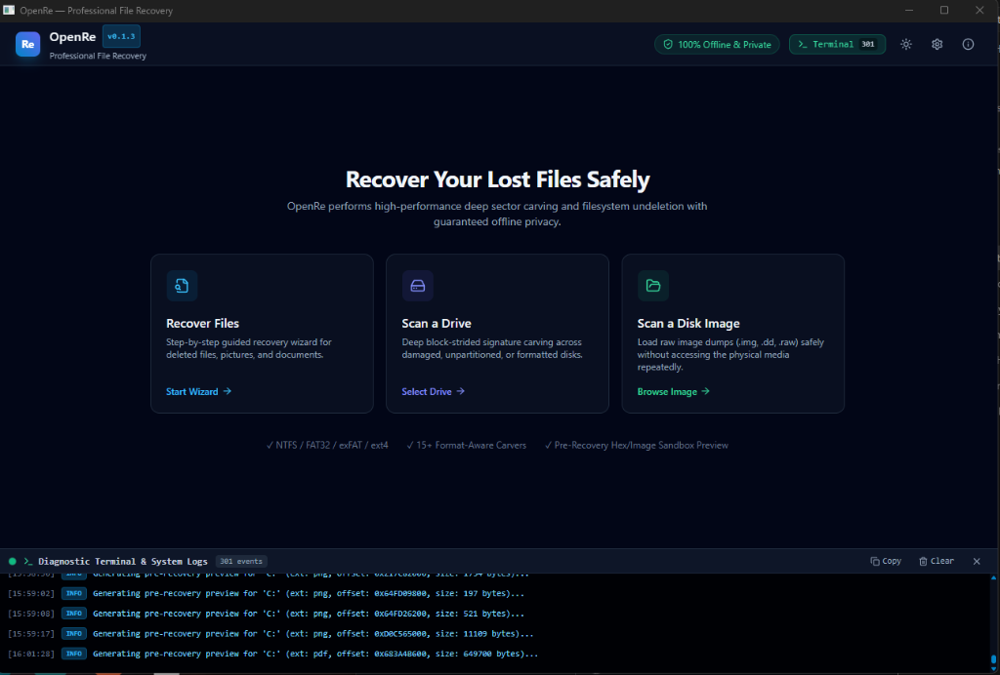
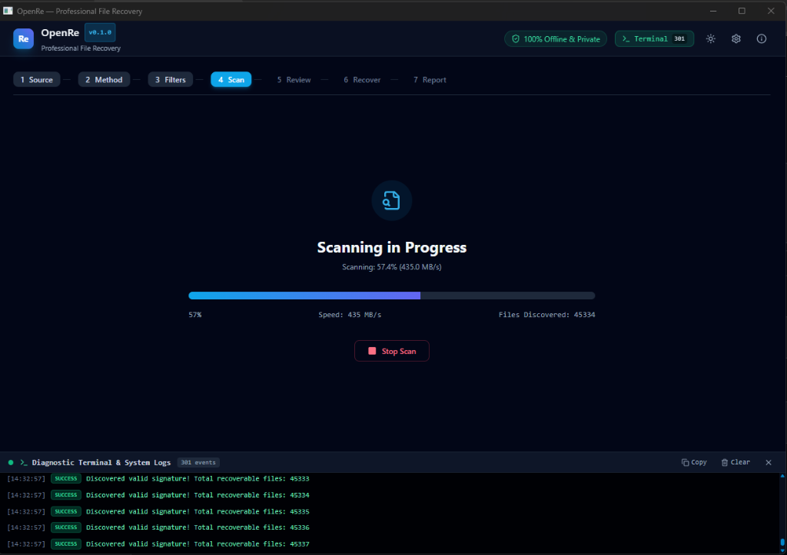
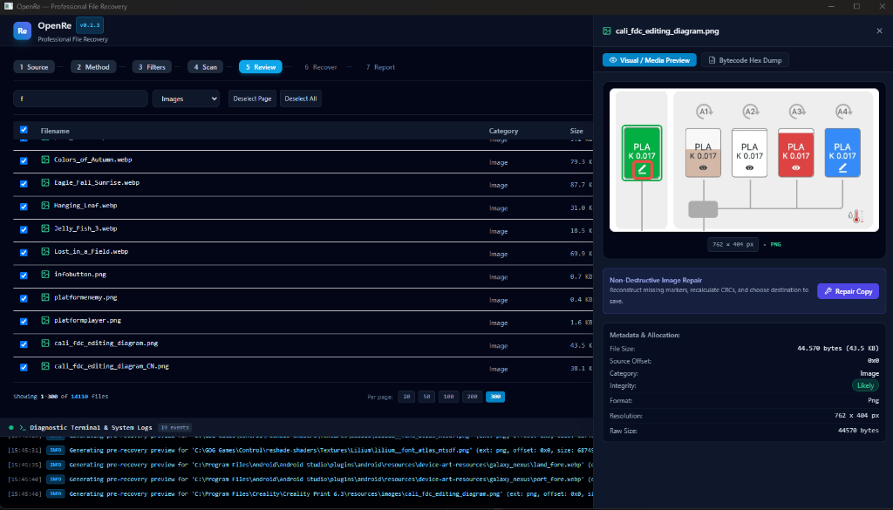
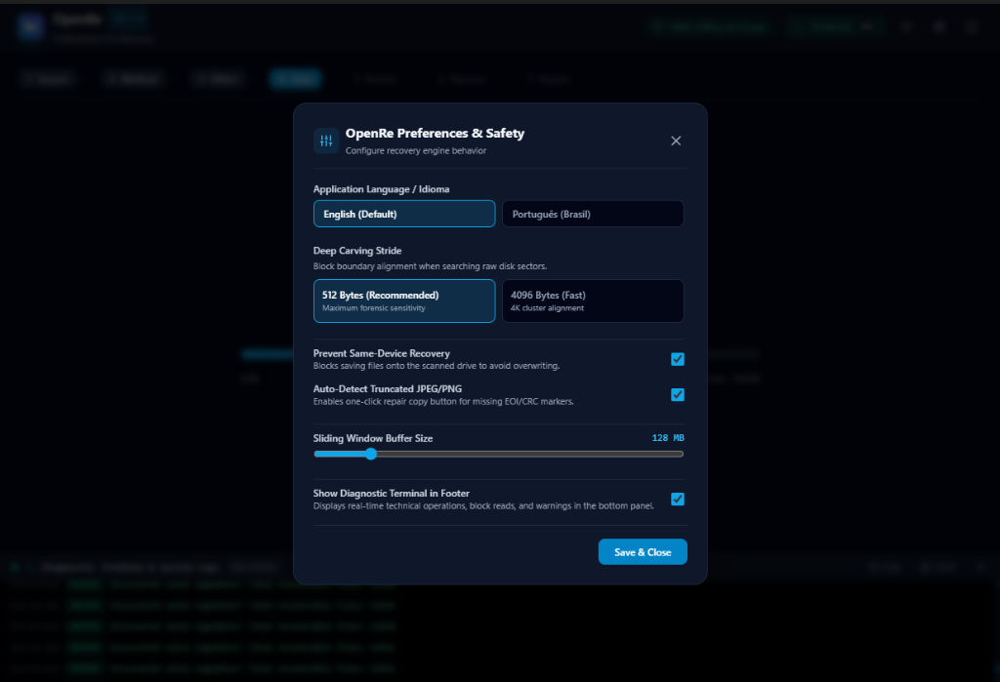

# OpenRe — Professional, Open-Source File Recovery

[](LICENSE)
[]()
[]()
[]()

> **OpenRe** is a genuine, modern, privacy-first desktop application for deleted file recovery, forensic disk carving, and file repair. Built in Rust and Tauri, OpenRe operates 100% offline without telemetry, cloud dependencies, or tracking.

---

## 📸 Interface Screenshots

<div align="center">
  
  <p><em>OpenRe Guided Dashboard — Intuitive entry points for deleted file recovery, disk carving, and raw disk images.</em></p>
</div>

<br>

<div align="center">
  
  <p><em>High-Performance Scan Engine — Real-time progress, read speed (MB/s), file counters, and integrated live diagnostics terminal.</em></p>
</div>

<br>

<div align="center">
  
  <p><em>Review & Instant Sandbox Preview — View multimedia streams, inspect byte sectors, review metadata allocation, and save recovered files directly.</em></p>
</div>

<br>

<div align="center">
  
  <p><em>Forensic Preferences & Safety Controls — Configurable carving stride (512 vs 4096 bytes), buffer sizes, language, and same-drive collision protection.</em></p>
</div>

---

## 📖 Translations / Traduções
- 🇧🇷 **Guia de Instalação e Uso em Português do Brasil:** [docs/installation/INSTALLATION_PT_BR.md](docs/installation/INSTALLATION_PT_BR.md)
- 🇬🇧 **English User & Installation Manual:** [docs/installation/INSTALLATION_EN.md](docs/installation/INSTALLATION_EN.md)

---

## ✨ Key Capabilities

- ⚡ **Quick Scan (Filesystem Undeletion):**
  - Instant metadata recovery for **NTFS** (`$MFT`), **FAT32** (LFN & `0xE5` entries), **exFAT**, and **ext4** (deleted inodes).
  - Preserves original filenames, nested folder hierarchies, creation/modification timestamps, and file sizes.
- 🔬 **Deep Scan (Format-Aware File Carving):**
  - Block-strided raw scanning for formatted, corrupted, or unpartitioned storage devices.
  - Validates internal structure, not just magic bytes, to eliminate false positives:
    - **Images:** JPEG, PNG, GIF, WebP, BMP, TIFF.
    - **Documents:** PDF, TXT, DOCX, XLSX, PPTX, ZIP.
    - **Media:** MP3, WAV, MP4, MOV, MKV.
- 👁️ **Safe Pre-Recovery Preview:**
  - View image thumbnails, hex dumps with ASCII inspection, and document summaries safely inside an untrusted sandbox before recovering.
- 🛠️ **Non-Destructive File Repair:**
  - Detects truncated images and missing markers (e.g. JPEG `FF D9` EOI).
  - Recalculates damaged PNG chunk CRCs.
  - Automatically creates repaired copies (`*.repaired.ext`) without altering original recovered files.
- 💾 **Raw Disk Imaging:**
  - Clone failing physical storage devices directly into raw `.img` or `.dd` disk images with error map logging.
- 🛡️ **Safety Guardrails:**
  - Enforces read-only access to source drives.
  - Strictly prevents saving recovered files onto the same drive being scanned.
- 🔒 **100% Offline & Private:**
  - Zero telemetry, zero analytics, zero external network requests. Verified by automated CI security audits.

---

## 🖥️ Supported Platforms & Downloads

| Platform | Distribution Format | Requirements |
| :--- | :--- | :--- |
| **Windows 10 / 11 (x64)** | [`OpenRe-Windows-x64-Portable.zip`](https://github.com/mateuspaulo/openre/releases/latest) | Standalone portable executable (`OpenRe.exe`), no installation required. |
| **Ubuntu / Debian / Mint (amd64)** | [`openre_amd64.deb`](https://github.com/mateuspaulo/openre/releases/latest) | `sudo apt install ./openre_amd64.deb` (includes desktop launcher & icon). |
| **Linux Universal (x86_64)** | [`OpenRe-Linux-x64.tar.gz`](https://github.com/mateuspaulo/openre/releases/latest) | Portable static Musl distribution for Fedora, Arch, SUSE, Alpine, etc. |

---

## 🚀 Quick Start (Windows Portable)

1. Download `OpenRe-Windows-x64-Portable.zip`.
2. Extract the archive to an external USB drive or secondary drive. *(Never extract onto the drive containing lost files!)*
3. Double-click `OpenRe.exe`.
4. Follow the 7-step guided workflow:
   - **Step 1:** Select Source Drive, Folder, or Disk Image.
   - **Step 2:** Select Recovery Mode (Quick Scan or Deep Scan).
   - **Step 3:** Apply optional filters (file categories, extensions, sizes).
   - **Step 4:** Run Scan with real-time speed, progress, and file counter.
   - **Step 5:** Review results, inspect thumbnails, and check integrity ratings.
   - **Step 6:** Choose a safe destination directory (on a different drive).
   - **Step 7:** View the recovery audit report.

---

## ⚙️ Building from Source

### Prerequisites
- [Rust 1.80+](https://www.rust-lang.org/)
- [Node.js 20+](https://nodejs.org/) & `npm`

```bash
# Clone the repository
git clone https://github.com/openre/openre.git
cd openre

# Compile Rust workspace & CLI diagnostic tool
cargo build --release

# Run comprehensive test suite
cargo test

# Install frontend dependencies and launch desktop GUI
npm install
npm run tauri dev
```

For complete instructions, see [docs/development/BUILDING.md](docs/development/BUILDING.md).

---

## 🔒 Privacy & Threat Model

OpenRe is built with an absolute privacy guarantee. Data recovery frequently handles personal, sensitive, or confidential records. OpenRe guarantees:
- **No telemetry, tracking, or analytics:** The recovery core does not include networking libraries.
- **Local-only execution:** Scanning, carving, and previews happen 100% on your local CPU.
- Read our full [Privacy Design](docs/privacy/PRIVACY_DESIGN.md) and [Threat Model](docs/security/THREAT_MODEL.md).

---

## ⚠️ Important Recovery Disclaimer

> Data recovery is not 100% guaranteed. Factors such as physical head failure, media wear, SSD TRIM deallocation, and cluster overwriting can make lost data permanently unrecoverable. Cease all write operations on affected drives immediately to maximize recovery success.

---

## 📜 License & Governance

OpenRe is licensed under the [MIT License](LICENSE).  
See [CONTRIBUTING.md](CONTRIBUTING.md), [SECURITY.md](SECURITY.md), and [CODE_OF_CONDUCT.md](CODE_OF_CONDUCT.md) for community policies.
